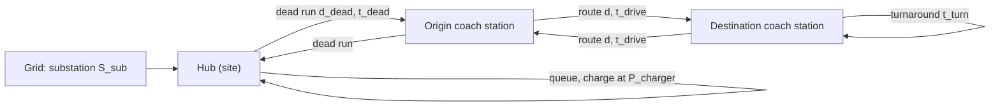

# Ember Hub Simulator: theory

White paper for the code in this repository. Keep it in sync with the model: when a relation changes, update this file
in the same commit. This is an operations and cost model (fleet, charging, drivers, site, cost), not a physics model;
it uses simcore only for run folders and unit conversion. Every sizing and cost relation is a port of the Ember Google
Sheet (https://docs.google.com/spreadsheets/d/1JA1vhd5hy175fAC6ntpBEyc8LP3ZElmjUSfAdHF0P70, state of 2026-10-28);
cell references are to the tab "Site Selection" unless prefixed `IV!` ("Inputs & Variables").

## 1. System description

A departure leaves the origin every headway `h` during the service hours. Each coach runs a rotation: dead run to the
origin, outbound, turnaround, inbound, dead run back to the hub, recharge.

## 2. Sizing (sheet port, `HubModel`)

| Quantity | Relation | Cell |
|---|---|---|
| Trips per day | `n_d = T_service / h` | IV!I15 |
| Energy per rotation | `E_rot = 2 d e + 2 d_dead e` (consumption `e`, kWh/km) | I13 |
| SOC at plug-in | `1 - E_rot / E_batt`, must be >= min. SOC | I14, I15 |
| Charge time | `t_ch = E_rot / P_charger` (full charger power, no taper) | I16 |
| Return cycle | `t_cyc = 2 t_drive + t_turn + t_break + 2 t_dead + t_ch` | I17 |
| Fleet | `N = ceil(t_cyc / h)`, plus maintenance spare | I18, I19 |
| Active chargers | `ceil((t_ch / h) / u_max)` | I20 |
| Chargers | active + backup | I21 |
| Peak load | `N_ch P / (eta PF) + S_aux` (the standby charger is counted) | I22 |
| Substation | smallest BS EN 60076 rating >= `S_peak / u_max`; none above 4,000 kVA | I23 |
| Driving per shift | `2 t_drive + 2 t_dead` | I24 |
| Shift | driving + pre/post checks + destination break | I25 |
| EU check | one leg incl. dead run <= 4:30, driving <= 9:00, break >= 0:45 | I26 |
| Shifts per driver | `min(days, floor(T_week / t_shift))` | I27 |
| Drivers | `ceil(trips per week / shifts x (1 + cover))` | I28 |
| Peak drivers | `ceil(t_shift / h)` | I29 |
| Hub area | net footprint (sheet 2.3, bays x fleet, chargers, 2 car spaces per peak driver) x gross-to-net | I30 |
| Feasible | battery, EU and area checks pass and a standard substation exists | I32 |

## 3. Annual cost

Capital items are annualised with the spreadsheet `PMT`:

$$ A = PV \frac{r}{1 - (1 + r)^{-n}} $$

| Item | Relation | Cell |
|---|---|---|
| Land lease | site area x rent | I35 |
| Site works | `A(r, n_infra, area_req x civils)` | I36 |
| Chargers | `A(r, n_charger, N_ch x capex)` | I37 |
| Grid connection | `A(r, n_infra, fixed + cable x distance + reinforcement x max(0, S_sub - spare))` | I38 |
| Fleet | coaches x coach cost / coach life (straight line, no discounting) | I39 |
| Driver wages | trips per year x shift x wage x (1 + cover) | I40 |
| Electricity | `(trips/yr x E_rot / eta + S_aux PF x 8,760 h) x price` | I41 |

Cost per trip = total / trips per year; the feasible site with the lowest total ranks 1 (I43 to I45).

**Deviation from the sheet.** Trips per year use `365 x days per week / 7` operating days; the sheet uses 365 whatever
the days per week. The two agree at the baseline (7 days).

## 4. Operating-day simulation (`DaySimulation`, new)

Time steps of `dt` (1 min). State per coach: mode (parked, dead run out, outbound, turnaround, inbound, dead run in,
queued, charging), leg start time and energy.

1. **Dispatch.** At `t_dep - t_dead` the coach at the hub with the most energy leaves, if it holds
   `E_rot + SOC_min E_batt`; it unplugs if charging. Otherwise the departure waits (runs late).
2. **Legs.** Durations: dead run `t_dead`; outbound and inbound `t_drive + t_break / 2`; turnaround `t_turn`. Energy
   falls linearly with distance over each leg.
3. **Charging.** Returning coaches queue first come, first served for the **active** chargers (the standby charger is
   not used) and charge at constant power to full: `dE/dt = P_charger`.
4. **Grid load.** `S = n_charging P / (eta PF) + S_aux`.

The run starts with every coach full at the hub and simulates one warm-up day before the reported horizon. Outputs:
coach states, SOC and charger use per step; on-time departures (delay <= 1 min), queue waits, SOC at plug-in, grid
load and energy, drivers on duty (sign-on `pre-check` before hub departure, sign-off `post-check` after return).

Checks in `tests/test_model.py`: the day's grid energy equals trips x `E_rot / eta` + auxiliary energy; every coach is
either on the road or at the hub; charging coaches never exceed the active chargers; SOC stays within
[SOC_min, 100 %].

## 5. Hub design (`HubDesign`, imported)

The hub layout is not generated here. `tools/export_design.py` imports the final Temple Works design from
Ember-Site-Selection (`scripts/hub_design.py`, drawings EMB-HUB-003 and EMB-HUB-005): the real yards traced from the
Savills plan onto HM Land Registry title 19736799, in the project's local site grid (`scripts/site_frame.py`: origin at
the title's south-west corner, u along the railway boundary) with an affine map to lon/lat for the web map.

| Variant | Lanes | Charging | Movements checked |
|---|---|---|---|
| base (EMB-HUB-003) | 8 single-depth drive-through lanes, 4.0 x 15 m | 2 x 600 kW gantry, lanes 1-4 wired | 16, min. clearance 0.58 m |
| expansion (EMB-HUB-005) | 11 lanes | as base, +2 chargers reserved | 22, min. clearance 0.58 m |

The simulator uses the smallest variant with a lane for every coach (fleet incl. spare) and flags a fleet above 11.
Coaches at the hub are drawn in the design's lanes: charging coaches in the wired lanes, parked coaches in the others,
queued coaches on the inbound aisle. The swept-path envelopes and clearances shown are the design's own (kinematic
bicycle model with an assumed 7.2 m wheelbase; confirm with AutoTURN). For sites other than S1 there is no detailed
design: the views show the S1 design for reference and feasibility rests on the sheet's area check.

## 6. Routes and site screening (`geo.py`)

* Bristol: the sheet's route (ORS driving-hgv, Bristol Coach Station to Victoria) and the ORS dead run from the coach
  station to the Temple Works hub (3.3 km, 9 min in the sheet) are drawn from the QGIS project.
* Other routes: OSRM (car profile). Coach drive time = car time x a factor calibrated so Bristol Coach Station to London
  Victoria gives the sheet's 3:07. Dead runs: OSRM table, car time + 3 min yard time.
* Screening (port of the QGIS `01_screen_sites.py`): OSM brownfield / industrial / commercial / greenfield polygons
  around the origin (Overpass). Filters: area >= 4,000 m², short side >= 40 m, dead run <= 15 km (estimated as route
  chainage + 1.4 x offset, or 1.4 x straight line). Score: dead run 40 %, distance to a >= 33 kV substation 25 %,
  area 15 %, shape 10 %, land use 10 %. The best 15 get OSRM road dead-runs.
* OSM substations are a proxy for grid capacity; check headroom on the NGED Network Opportunity Map.

## 7. Limits

* Costs are the sheet's placeholders; screened and custom sites use a placeholder rent (£20/m²/yr) and spare grid
  capacity (1,000 kVA).
* Charging is constant power (no taper above ~80 % SOC); consumption does not vary with season, traffic or HVAC.
* Only S1 has a detailed hub design.
