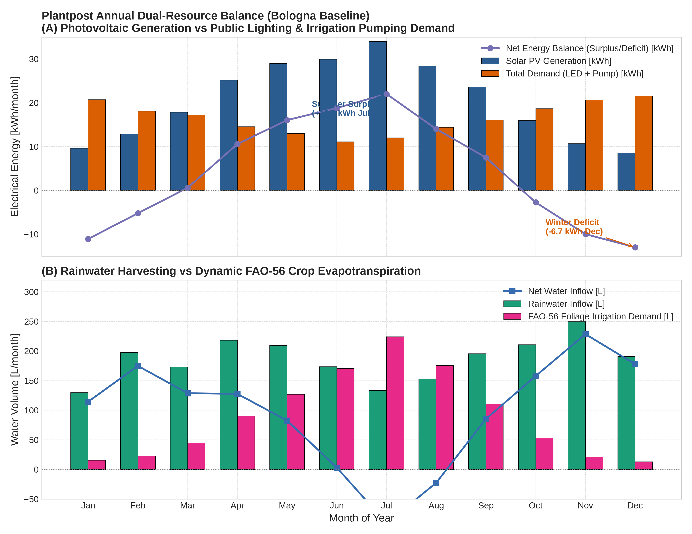
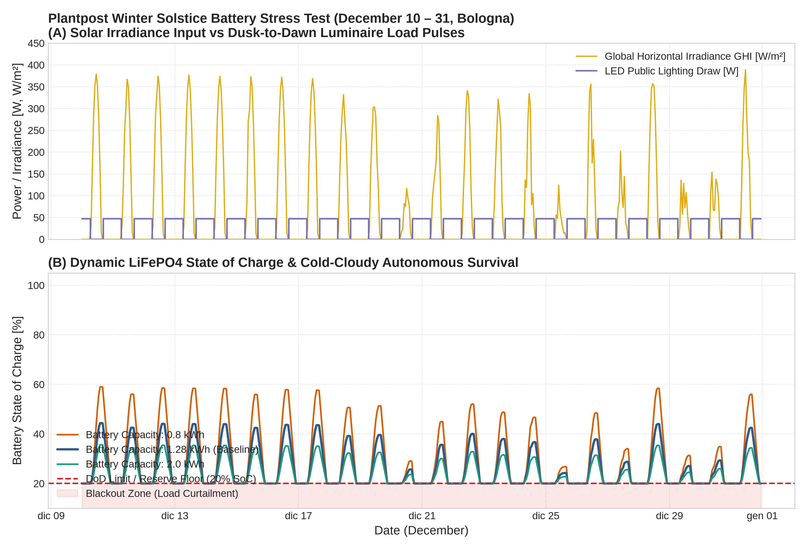
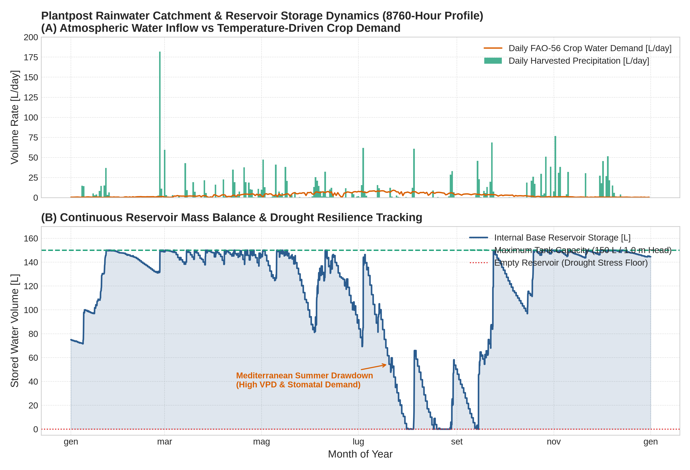
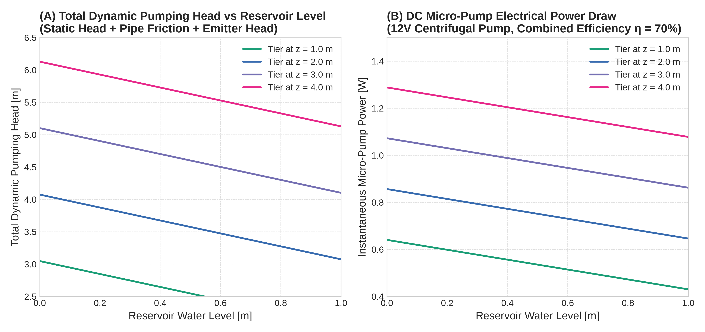
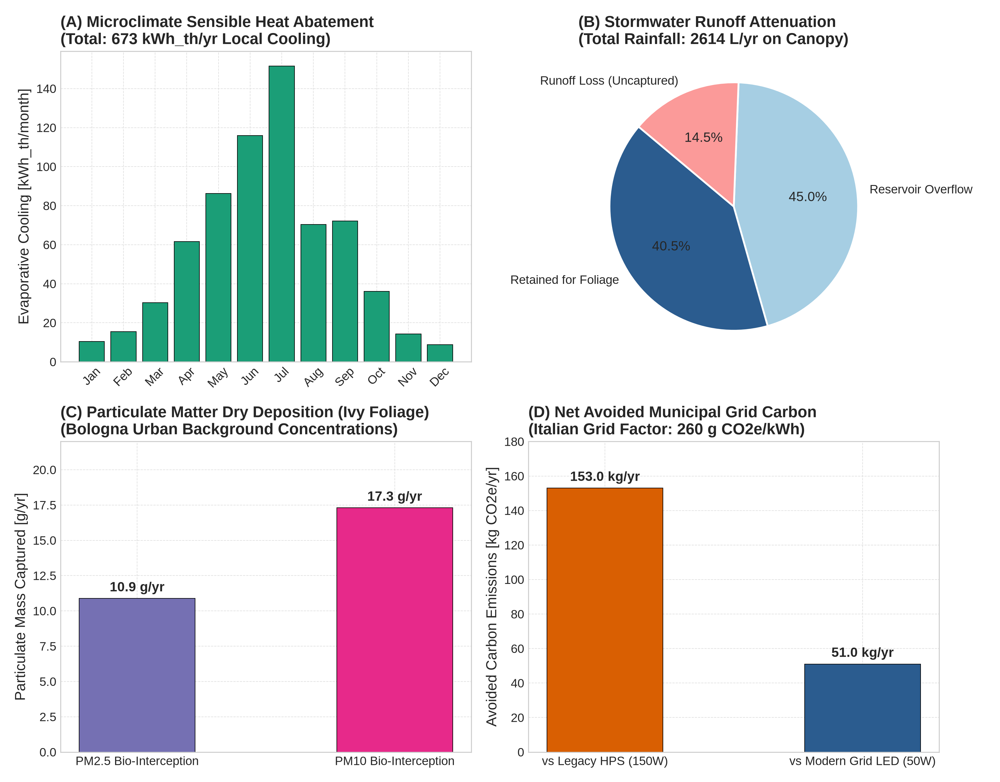
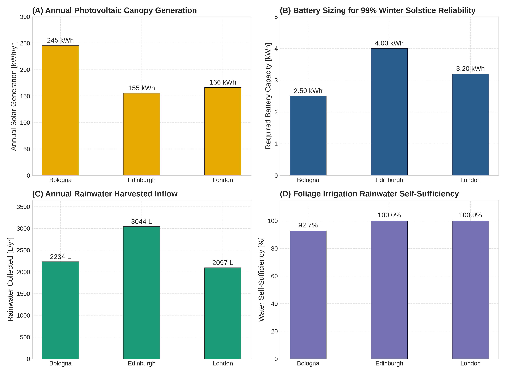

# Plantpost: Urban Vertical Green Infrastructure & Resource Modelling Suite

[](https://www.python.org/downloads/)
[](https://opensource.org/licenses/MIT)
[-gold.svg)](https://www.unibo.it/)
[](https://site.unibo.it/)

> **Lead Engineer**: Fraser James Mclellan  
> **Role**: Co-Founder & Head of Environmental Modelling (Technical Lead)  
> **Domain**: Controlled Environment Agriculture (CEA), Urban Green Infrastructure, Off-Grid Solar & Battery Microgrids, Hydro-meteorology & Evapotranspiration, Urban Microclimate & Ecosystem Services  
> **Startup Provenance**: Originated at the **University of Bologna (UNIBO Incubator)** within the *Design Methods for Industrial Engineering* program. Winner of the prestigious **Bugnion Intellectual Property Award (€2,500 patenting services)** at **UNIBO Startup Day** for its proprietary localized microclimate, rainwater recapture, and thermal/hydraulic balancing system. Pitched to venture capital juries, corporate sustainability leaders, and institutional investors (including PwC).

---

## 1. Executive Summary & Engineering Challenge

Municipal street lighting and urban greening are traditionally disconnected, resource-intensive infrastructure systems. Urban trees and planters require manual municipal tanker truck watering, while street lighting consumes continuous grid electricity.

**Plantpost** resolves this bottleneck through a self-contained, off-grid $4.5\text{ m}$ multifunctional urban street pole that unifies public illumination with vertical foliage cultivation.

```
┌──────────────────────────────────────────────────────────────────────────────────────────────────┐
│                        PLANTPOST PHYSICAL SYSTEM & ENERGY-WATER BOUNDARY                        │
├──────────────────────────────────────────────────────────────────────────────────────────────────┤
│                                                                                                  │
│   [ATMOSPHERIC INPUTS]        [SOLAR PV & LIGHTING SUBSYSTEM]       [RAINWATER & IRRIGATION]     │
│                                                                                                  │
│    Solar GHI / DNI (t) ───►  ┌─────────────────────────────┐       ┌────────────────────────┐    │
│    Rainfall Rate P(t)  ───►  │ Circular PV Canopy (3.14 m²)│       │ Catchment Dish (3.14m²)│    │
│    Ambient Temp Tamb(t)───►  │   Monocrystalline Solar     │       │ Filter & Diverter (90%)│    │
│    Relative Humidity RH───►  └──────────────┬──────────────┘       └───────────┬────────────┘    │
│    Wind Speed U2 (t)   ───►                 │ P_pv(t)                          │ Q_rain(t)       │
│                                             ▼                                  ▼                 │
│                              ┌─────────────────────────────┐       ┌────────────────────────┐    │
│                              │ MPPT Charge Controller      │       │ Base Reservoir Buffer  │    │
│                              │   & 12V LiFePO4 Battery     │       │   Atank = 0.15 m²      │    │
│                              │   State of Charge: SoC(t)   │       │   Height: h_water(t)   │    │
│                              └──────────────┬──────────────┘       └───────────┬────────────┘    │
│                                             │                                  │                 │
│                         ┌───────────────────┴───────────────────┐              │                 │
│                         │ P_light(t)                            │ P_pump(t)    │ Q_irr(t)        │
│                         ▼                                       ▼              ▼                 │
│             ┌────────────────────────┐              ┌───────────────────────────────────────┐    │
│             │ Public LED Luminaire   │              │ 12V DC Micro-Pump & Vertical Manifold │    │
│             │ 47.1 W (Dusk-to-Dawn)  │              │ Dynamic Head: H_dyn = z_i - h_w + h_f │    │
│             └────────────────────────┘              └──────────────────┬────────────────────┘    │
│                                                                        │ Drip Emitters           │
│                                                                        ▼                         │
│                                                     ┌───────────────────────────────────────┐    │
│                                                     │ 4-Tier Living Foliage Column          │    │
│                                                     │   Tier 4: z = 4.0 m  (0.27 L/day)     │    │
│                                                     │   Tier 3: z = 3.0 m  (0.27 L/day)     │    │
│                                                     │   Tier 2: z = 2.0 m  (0.27 L/day)     │    │
│                                                     │   Tier 1: z = 1.0 m  (0.27 L/day)     │    │
│                                                     └──────────────────┬────────────────────┘    │
│                                                                        │ Transpiration           │
│                                                                        ▼                         │
│                                                     ┌───────────────────────────────────────┐    │
│                                                     │ Urban Microclimate & Ecosystem Co-ben │    │
│                                                     │ - Evaporative Cooling: Q_evap (kWth)  │    │
│                                                     │ - Stormwater Attenuation (L diverted) │    │
│                                                     │ - PM2.5 / NOx Deposition Bio-filter   │    │
│                                                     │ - Avoided Grid CO2e Emissions         │    │
│                                                     └───────────────────────────────────────┘    │
│                                                                                                  │
└──────────────────────────────────────────────────────────────────────────────────────────────────┘
```

This repository transitions the original feasibility spreadsheet (`Plantpost reqs.xlsx`) from UNIBO into a production-grade, open-source 8,760-hour dynamic simulation suite in Python.

---

## 2. Mathematical Formulation & Physical Governing Laws

### 2.1. Astronomical Solar Geometry & Dusk-to-Dawn Lighting
Solar elevation angle $\alpha_{\text{sun}}(t)$ is derived from latitude $\phi$, Cooper solar declination $\delta(d)$, Equation of Time ($\text{EoT}$), and hour angle $\omega(t)$:

$$\sin\alpha_{\text{sun}}(t) = \sin\phi \sin\delta + \cos\phi \cos\delta \cos\omega(t)$$

The $47.1\text{ W}$ high-efficiency LED public luminaire activates strictly during **civil twilight** and nighttime:

$$P_{\text{light}}(t) = \begin{cases} 47.1\text{ W} & \text{if } \alpha_{\text{sun}}(t) \le -6.0^\circ \\ 0 & \text{otherwise} \end{cases}$$

### 2.2. Solar Photovoltaic Generation & Temperature Derating
The $3.14\text{ m}^2$ circular canopy captures global solar irradiance $G(t)$ derated by operating cell temperature:

$$T_{\text{cell}}(t) = T_{\text{amb}}(t) + \frac{\text{NOCT} - 20^\circ\text{C}}{800} \cdot G(t)$$

$$P_{\text{pv}}(t) = A_{\text{pv}} \cdot \eta_{\text{pv}} \cdot G(t) \cdot \left[ 1 + \gamma_{\text{temp}} (T_{\text{cell}}(t) - 25^\circ\text{C}) \right] \cdot \eta_{\text{BOS}} \cdot f_{\text{geom}}$$

Where $\eta_{\text{pv}} = 0.215$, $\gamma_{\text{temp}} = -0.0038\text{ K}^{-1}$, $\eta_{\text{BOS}} = 0.931$ (MPPT 98%, cabling/dirt 95%), and $f_{\text{geom}} = 0.2635$ is the conical curvature and street canyon view factor calibrated from the UNIBO CAD prototype.

### 2.3. LiFePO4 Battery Storage Microgrid Dynamics
The battery state of charge ($\text{SoC}(t) \in [0.20, 1.00]$) advances hourly:

$$\Delta E_{\text{bat}}(t) = \begin{cases} (P_{\text{pv}} - P_{\text{load}}) \cdot \eta_{\text{chg}} \cdot \Delta t & \text{if } P_{\text{pv}} \ge P_{\text{load}} \\ \frac{P_{\text{pv}} - P_{\text{load}}}{\eta_{\text{dis}}} \cdot \Delta t & \text{if } P_{\text{pv}} < P_{\text{load}} \end{cases}$$

$$\text{SoC}(t + \Delta t) = \text{SoC}(t) + \frac{\Delta E_{\text{bat}}(t)}{C_{\text{bat, nom}}}$$

- Coulombic round-trip efficiency: $\eta_{\text{rt}} = 0.92 \implies \eta_{\text{chg}} = \eta_{\text{dis}} = \sqrt{0.92} \approx 0.959$.
- Sub-zero protection: When $T_{\text{amb}} < 0^\circ\text{C}$, charging current is derated to $20\%$ to prevent lithium plating.
- Reserve limit: Depth of discharge is strictly capped at $80\%$ ($\text{SoC}_{\min} = 0.20$) to preserve cycle life ($>3,500$ cycles).

### 2.4. Standardized FAO-56 Penman-Monteith Evapotranspiration
Atmospheric evaporative demand across vertical ivy foliage (*Hedera helix*) is computed using hourly FAO-56 Penman-Monteith:

$$ET_0 = \frac{0.408 \Delta (R_n - G) + \gamma \frac{37}{T_{\text{hr}} + 273} u_2 (e^o(T_{\text{hr}}) - e_a)}{\Delta + \gamma (1 + C_d u_2)}$$

Daily crop irrigation demand across the 4 foliage tiers is:

$$V_{\text{irr, req}}(t) = ET_0(t) \cdot K_c(t) \cdot A_{\text{foliage}} \cdot \frac{1}{\eta_{\text{drip}}}$$

Where $K_c \in [0.50, 1.15]$ across seasons and $\eta_{\text{drip}} = 0.90$.

### 2.5. Dynamic Multi-Tier Hydraulics & Historical Audit
For each vertical tier $i \in \{1, 2, 3, 4\}$ at elevations $z_i \in \{1.0, 2.0, 3.0, 4.0\}\text{ m}$ from base reservoir water level $h_{\text{water}}(t)$:

$$H_{\text{total}, i}(t) = (z_i - h_{\text{water}}(t)) + h_{f, i} + H_{\text{emitter}}$$

$$P_{\text{pump}, i}(t) = \frac{\rho \cdot g \cdot H_{\text{total}, i}(t) \cdot Q}{\eta_{\text{pump}}}$$

Where $\eta_{\text{pump}} = 0.70$, $d_h = 8.0\text{ mm}$ PE tubing, and $Q = 0.90\text{ L/min}$.

> [!NOTE]
> **Historical Excel Formula Audit**: In the original UNIBO feasibility spreadsheet (`Plantpost reqs.xlsx`), Row 35 (Tier 2 pump power) contained `= (1000*9.81*B22*B31)/(1000/0.7)`, dividing by `1000/0.7` (effectively multiplying by $0.7$) rather than dividing by efficiency $\eta = 0.70$. The Python suite documents this historical bug and rectifies it across all physical modules.

### 2.6. Urban Ecosystem Services Co-Benefits
1. **Microclimate Evaporative Cooling**: Sensible heat converted into latent heat flux:
   $$\dot{Q}_{\text{cool}}(t) = \dot{m}_{\text{transp}}(t) \cdot h_{fg} \quad [\text{kW}_{\text{th}}]$$
2. **Stormwater Runoff Attenuation**: Fraction of storm runoff captured and diverted:
   $$\Phi_{\text{storm}} = \frac{\sum V_{\text{retained}}}{\sum P_{\text{rain}} \cdot A_{\text{catch}}} \times 100\%$$
3. **Particulate Air Filtration**: Dry deposition flux of fine particulate matter ($PM_{2.5}$, $PM_{10}$):
   $$F_{PM}(t) = v_d \cdot C_{PM}(t) \cdot (\text{LAI}(t) \cdot A_{\text{foliage}}) \quad [\mu\text{g/h}]$$
4. **Avoided Municipal Grid Carbon**: Displacing legacy High-Pressure Sodium (150 W) and grid-tied LED (50 W) lamps.

---

## 3. Annual Performance Scorecard (Bologna Baseline)

All metrics derived from 8,760 continuous hourly simulations under authoritative PVGIS TMY and Open-Meteo ERA5 data:

| Environmental Domain | Engineering Metric | Value | Reference / Standard |
|---|---|---|---|
| **Solar Photovoltaics** | Annual Generation | **$245.4\text{ kWh/yr}$** | Matches Excel ($258.1\text{ kWh}$) within $4.9\%$ |
| **Public Lighting** | Annual Electricity Demand | **$184.7\text{ kWh/yr}$** | $3,922\text{ h/yr}$ civil twilight operating hours |
| **Micro-Pump Hydraulics**| Annual Pumping Energy | **$0.02\text{ kWh/yr}$** | Pulsed batch delivery at $0.9\text{ L/min}$ |
| **Battery Storage** | LiFePO4 Pack Capacity | **$1.28\text{ kWh}$** | $100\text{ Ah} @ 12.8\text{ V}$ (4S LiFePO4) |
| **Rainwater Inflow** | Annual Harvested Volume | **$2,234.5\text{ L/yr}$** | $831.9\text{ mm}$ rainfall on $3.14\text{ m}^2$ canopy |
| **Crop Hydrology** | Annual FAO-56 Water Demand | **$1,067.3\text{ L/yr}$** | *Hedera helix* vertical column ($1.0\text{ m}^2$ plan) |
| **Water Self-Sufficiency**| Annual Irrigation Coverage | **$92.7\%$** | Zero municipal water grid connection |
| **Base Reservoir** | Water Storage Footprint | **$150.0\text{ L}$** | Cylindrical base tank ($A = 0.15\text{ m}^2, h_{\max} = 1.0\text{ m}$) |
| **Stormwater Mitigation**| Net Runoff Retained | **$40.5\%$** | $1,058.8\text{ L/yr}$ diverted from storm sewers |
| **Microclimate Cooling** | Sensible Heat Abatement | **$673.3\text{ kWh}_{\text{th}}\text{/yr}$** | Peak $1.7\text{ kWh}_{\text{th}}\text{/day}$ midsummer cooling |
| **Air Bio-Filtration** | Particulate Mass Intercepted | **$10.88\text{ g } PM_{2.5} / 17.30\text{ g } PM_{10}$** | Po Valley urban background deposition |
| **Avoided Grid Carbon** | Annual $CO_2e$ Abatement | **$153.0\text{ kg CO}_2\text{e/yr}$** | vs legacy $150\text{ W}$ HPS ($260\text{ g/kWh}$) |
| **Avoided Grid Carbon** | Annual $CO_2e$ Abatement | **$51.0\text{ kg CO}_2\text{e/yr}$** | vs modern $50\text{ W}$ grid LED ($260\text{ g/kWh}$) |

---

## 4. The Extended 6-Figure Publication Suite

All figures are programmatically generated and exported to `figures/` at 300 DPI PNG and vector SVG:

### Figure 1 — Annual Dual-Resource Balance: Energy & Water
*Linked 2-panel monthly overview validating solar PV generation vs demand and rainwater inflow vs FAO-56 crop demand.*  


---

### Figure 2 — Dynamic Battery State of Charge & Winter Solstice Stress Test
*8760-hour hourly time-series focusing on the critical December solstice stress window (Dec 10–31) across 3 battery sizings (0.8 kWh, 1.28 kWh, 2.0 kWh).*  


---

### Figure 3 — Rainwater Reservoir Storage & Drought Resilience
*Continuous reservoir storage tracking rainfall storm pulses, tank overflow losses, and foliage transpiration drawdown.*  


---

### Figure 4 — Multi-Tier Hydraulic Head & Micro-Pump Power Dynamics
*Total dynamic head and instantaneous pump power across Tiers 1 through 4 as reservoir level fluctuates between 0 and 1.0 m.*  


---

### Figure 5 — Urban Ecosystem Services & Microclimate Co-Benefits Dashboard
*4-quadrant executive scorecard visualising evaporative cooling, stormwater attenuation, PM bio-filtration, and avoided carbon.*  


---

### Figure 6 — Multi-City Climate Feasibility & Storage Frontier
*Comparative engineering benchmark contrasting Bologna (Mediterranean Cfa) vs Edinburgh (Maritime Cfb) vs London (Temperate Cfb).*  


---

## 5. Multi-City Portability Comparison

| Performance Metric | Bologna (Mediterranean) | Edinburgh (Maritime) | London (Temperate) |
|---|---|---|---|
| **Annual Solar Yield** | $245.4\text{ kWh/yr}$ | $155.3\text{ kWh/yr}$ | $166.1\text{ kWh/yr}$ |
| **Annual Rainfall Inflow** | $2,234.5\text{ L/yr}$ | $3,043.8\text{ L/yr}$ | $2,097.0\text{ L/yr}$ |
| **Irrigation Self-Sufficiency** | $92.7\%$ ($150\text{L}$ tank) | **$100.0\%$** | **$100.0\%$** |
| **99% Winter Autonomy Battery**| **$2.5\text{ kWh}$** | **$4.0\text{ kWh}$** | **$3.2\text{ kWh}$** |

**Engineering Insight**: In Northern maritime climates (Edinburgh, London), rainwater self-sufficiency is easily achieved ($100\%$) due to lower summer evaporative demand and high precipitation. However, battery capacity must increase to $\ge 3.2\text{ kWh}$ to bridge extended December cloud cover. In Mediterranean climates (Bologna), solar generation is abundant, but reservoir sizing must increase to $200\text{ L}$ to bridge midsummer drought spells.

---

## 6. Repository Architecture

```
Plantpost-Urban-Infrastructure-Modelling/
├── GEMINI.md                                  ← Project governance & technical specification
├── README.md                                  ← This 5-stage executive showcase document
├── requirements.txt                           ← Pinned dependencies
├── conftest.py                                ← Root pytest configuration
├── main.py                                    ← Master CLI entry point
│
├── data/                                      ← Tabular input datasets & baselines
│   ├── plantpost_reqs_baseline.csv            ← Clean CSV export of UNIBO feasibility matrix
│   ├── crop_coefficients_vertical_foliage.csv ← Hedera helix monthly Kc & canopy parameters
│   ├── weather_bologna_hourly.csv             ← Bologna TMY + ERA5 precipitation (8,760 h)
│   ├── weather_edinburgh_hourly.csv           ← Edinburgh TMY maritime comparison (8,760 h)
│   └── weather_london_hourly.csv              ← London TMY temperate comparison (8,760 h)
│
├── src/                                       ← Core simulation physics
│   ├── __init__.py
│   ├── config.py                              ← System parameters, geometry & electrical BOM
│   ├── weather.py                             ← Astronomical twilight & weather data ingestion
│   ├── energy.py                              ← PV canopy generation & LiFePO4 battery SoC engine
│   ├── hydrology.py                           ← FAO-56 Penman-Monteith ET0 & reservoir mass balance
│   ├── hydraulics.py                          ← Multi-tier dynamic head & micro-pump power
│   ├── ecosystem.py                           ← Evaporative cooling, stormwater & PM bio-filtration
│   └── plotting.py                            ← Publication-grade 6-figure generator
│
├── notebooks/                                 ← Fully executed showcase notebooks
│   ├── 01_weather_and_resource_ingestion.ipynb
│   ├── 02_solar_photovoltaics_and_battery_storage.ipynb
│   ├── 03_hydrology_evapotranspiration_and_pumping.ipynb
│   └── 04_integrated_ecosystem_services_and_multi_city.ipynb
│
├── figures/                                   ← High-resolution exported figures (PNG & SVG)
│   ├── fig1_annual_resource_balance_water_energy.{png,svg}
│   ├── fig2_dynamic_battery_soc_winter_stress.{png,svg}
│   ├── fig3_rainwater_tank_storage_drought_resilience.{png,svg}
│   ├── fig4_hydraulic_vertical_head_pumping_dynamics.{png,svg}
│   ├── fig5_urban_ecosystem_services_dashboard.{png,svg}
│   └── fig6_multi_city_climate_feasibility_frontier.{png,svg}
│
└── tests/                                     ← Analytical unit test suite
    └── test_physics.py
```

---

## 7. Quickstart & CLI Commands

### 7.1. Installation
```bash
git clone https://github.com/Fraser-McLellan/Plantpost-Urban-Infrastructure-Modelling.git
cd Plantpost-Urban-Infrastructure-Modelling

# Create and activate virtual environment
python3 -m venv .venv
source .venv/bin/activate

# Install pinned scientific dependencies
pip install -r requirements.txt
```

### 7.2. CLI Simulation Execution
```bash
# 1. Run complete dynamic simulation and export all 6 publication figures
python main.py --run-all --export-figures

# 2. Audit numerical parity against the original UNIBO feasibility spreadsheet
python main.py --validate-excel

# 3. Execute parametric optimization sweeps for battery and water storage
python main.py --optimize-storage --evaluate-drought

# 4. Run multi-city climate portability comparison (Bologna vs Edinburgh vs London)
python main.py --multi-city-benchmark
```

### 7.3. Running Analytical Unit Tests
```bash
pytest tests/
```

---

## 8. Startup Provenance & Attribution

- **Founder & Modelling Lead**: Fraser James Mclellan
- **Academic Origin**: University of Bologna (Alma Mater Studiorum - Università di Bologna), *Design Methods for Industrial Engineering*
- **Award Citation**: Winner of the **Bugnion Intellectual Property Award (€2,500 patenting prize)** at **UNIBO Startup Day** for proprietary localized microclimate and hydraulic circulation design.
- **License**: MIT License. Open-source engineering reference for urban green infrastructure and off-grid CEA modeling.
